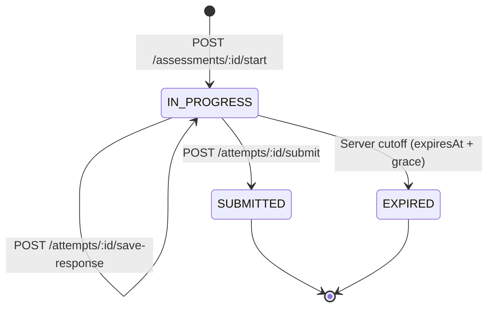

# Assessment Engine & Examination Integrity

## 1. Engine Objectives

The assessment engine powers two distinct evaluation formats:

1. **Chapter-wise Practice Tests**: Diagnostic tests designed for self-paced study.
2. **Full-Length Mock Examinations (100-Mark NEC / Lok Sewa Simulation)**: Rigorous simulation replicating official test standards, timing constraints, and negative marking penalties.

---

## 2. Server-Authoritative Timer & Attempt Lifecycle

Client-side timers are easily tampered with via browser developer tools or system clock adjustments. Therefore:

1. **Server Timestamping**: When an attempt is created, `startedAt` is recorded using server UTC time, and `expiresAt` is set to `startedAt + durationMinutes`.
2. **Grace Period**: A 30-second network latency buffer is permitted during submission. Any submission received after `expiresAt + 30s` is marked `EXPIRED`, and only answers saved prior to the deadline are graded.
3. **Continuous Response Saving**: The client automatically synchronizes selected answers every 30 seconds and immediately upon option selection.

---

## 3. Question Bank & Answer Protection

- **No Client-Side Leaks**:
  When `/assessments/:id/start` is called, the API serializes questions and answer options but **strictly omits**:
  - `isCorrect` on `AnswerOption`
  - `explanationText` on `Question`
- Options are shuffled server-side to prevent memorization by option position.
- Only upon transition to `SUBMITTED` or `EXPIRED` does the evaluation endpoint return correct keys and explanations.

---

## 4. Scoring Algorithm & Negative Marking

For each question in an attempt:

- If `selectedOptionId === null` (unanswered):
  - Marks awarded: `0.0`
- If `selectedOption.isCorrect === true`:
  - Marks awarded: `+question.marks` (e.g. `1.0`)
- If `selectedOption.isCorrect === false`:
  - Marks deducted: `-question.negativeMarks` (e.g. `0.20` marks, representing a 20% penalty)

`Total Score = Sum(marks awarded) - Sum(negative marks)` (floored at 0.0 or configured minimum).
`Accuracy % = (Correct Answers / Total Answered Questions) * 100`.

---

## 5. Mock Examination Blueprint Engine

A blueprint defines:

- Target Category & Faculty (e.g., NEC Civil Engineering).
- Total Questions: e.g. 100.
- Subject & Chapter Distribution Rules:
  - Subject 1 (Structural Engineering): 15 questions
  - Subject 2 (Geotechnical Engineering): 15 questions
  - Subject 3 (Water Resources): 15 questions
  - Subject 4 (Transportation): 15 questions
  - Subject 5 (Surveying & Construction Management): 20 questions
  - Subject 6 (Engineering Economics & Ethics): 20 questions
- Difficulty Weights: 50% Easy, 35% Medium, 15% Hard.
- Question Selection: Randomized from pool matching blueprint criteria.
