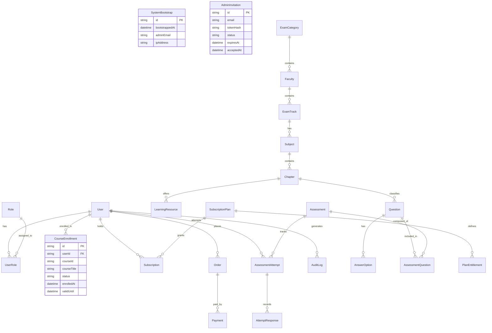

# Database Schema & Entity Relational Design

The database uses PostgreSQL managed through Prisma ORM (`backend/prisma/schema.prisma`).

## 1. Entity Relationship Overview

---

## 2. Key Tables & Field Definitions

### 2.1 Identity, Access Control & Bootstrap State

- **`User`**:
  - `id (UUID)`: Primary key.
  - `email (VarChar, unique)`: Normalized lowercase user email address.
  - `passwordHash (VarChar)`: Salted bcrypt/Argon2 password hash.
  - `fullName (VarChar)`: Student or administrator full name.
  - `phoneNumber (VarChar, optional)`: Contact phone number.
  - `isActive (Boolean)`: Active status flag (default `true`).
  - `isVerified (Boolean)`: Administrative verification status flag (default `false`).
  - `createdAt`, `updatedAt`: Automatic UTC timestamps.

- **`Role`**:
  - `id (UUID)`: Primary key.
  - `name (RoleType enum)`: Two primary application roles: `STUDENT` and `ADMIN` (plus internal `SUPER_ADMIN`).
  - `description (VarChar)`: Human-readable role description.

- **`UserRole`**:
  - `id (UUID)`, `userId (UUID)`, `roleId (UUID)`, `createdAt`: Join table linking users to assigned roles. Unique constraint on `(userId, roleId)`.

- **`SystemBootstrap`**:
  - `id (UUID)`: Primary key.
  - `bootstrappedAt (DateTime)`: Timestamp of the initial admin bootstrap.
  - `adminEmail (VarChar)`: Email address of the provisioned administrator.
  - `ipAddress (VarChar, optional)`: Host or terminal environment indicator.
  - **Invariants**: Strictly enforces a single initial administrator via atomic transaction checks.

- **`AdminInvitation`**:
  - `id (UUID)`: Primary key.
  - `email (VarChar)`: Invitee's designated email.
  - `tokenHash (VarChar)`: SHA-256 hash of the cryptographically generated single-use token.
  - `status (InvitationStatus enum)`: `PENDING`, `ACCEPTED`, `EXPIRED`, `REVOKED`.
  - `expiresAt (DateTime)`: Expiration timestamp (default 7 days).
  - `acceptedAt (DateTime, optional)`: Timestamp when invitation was redeemed.
  - `invitedById (UUID)`: Admin user who issued the invitation.

---

### 2.2 Course Enrollment & Orders

- **`CourseEnrollment`**:
  - `id (UUID)`: Primary key.
  - `userId (UUID)`: Reference to student `User`.
  - `courseId (VarChar)`: Identifier for the educational course or faculty track (e.g., `course-nec-civil`).
  - `courseTitle (VarChar)`: Display title of the enrolled course.
  - `status (EnrollmentStatus enum)`: `PENDING_VERIFICATION`, `ACTIVE`, `EXPIRED`, `REVOKED`.
  - `enrolledAt (DateTime)`: Timestamp of enrollment creation.
  - `validUntil (DateTime, optional)`: Expiration date of the course access.
  - **Rule**: One student can hold access to multiple courses simultaneously.

- **`Order`**:
  - `id (UUID)`: Primary key.
  - `orderNumber (VarChar, unique)`: Human-readable sequential reference (e.g. `ORD-20261012-ABC123`).
  - `userId (UUID)`: Ordering student.
  - `planId (UUID, optional)`: Associated subscription plan, if applicable.
  - `amountNpr (Decimal)`: Total payable NPR amount.
  - `status (OrderStatus enum)`: `PENDING`, `PAID`, `FAILED`, `CANCELLED`.
  - `receiptImageUrl (Text, optional)`: Base64 or object-storage URL of the student's eSewa payment transfer screenshot.
  - `transactionCode (VarChar, optional)`: Student-provided eSewa transaction code.
  - `paymentRemarks (Text, optional)`: Remarks and metadata provided during checkout.
  - `verificationNotes (Text, optional)`: Administrator review notes upon approval or rejection.
  - `verifiedById (UUID, optional)`: Admin user who reviewed and verified the order.
  - `verifiedAt (DateTime, optional)`: Timestamp of administrative verification.

- **`Payment`**:
  - `id (UUID)`: Primary key.
  - `orderId (UUID)`: Reference to `Order`.
  - `gateway (PaymentGateway enum)`: `ESEWA`, `KHALTI`.
  - `gatewayTransactionId (VarChar, unique)`: Gateway transaction identifier.
  - `amountNpr (Decimal)`: Confirmed payment amount.
  - `status (PaymentStatus enum)`: `INITIATED`, `SUCCESS`, `FAILED`, `REFUNDED`.

---

### 2.3 Educational Hierarchy & Content

- **`ExamCategory`**: Top-level exam groups (`NEC`, `LOK_SEWA`, `DIPLOMA`).
- **`Faculty`**: Engineering and technical branches (`Civil`, `Electrical`, `Mechanical`, `Computer`).
- **`ExamTrack`**: Specific qualification levels (`Officer 7th Level`, `Assistant 5th Level`).
- **`Subject`**: Academic disciplines within tracks (`Structural Engineering`, `Surveying`).
- **`Chapter`**: Granular topics containing study materials.
- **`LearningResource`**: PDF documents and Markdown notes with embedded viewing support.

---

### 2.4 Question Bank & Assessments

- **`Question`**: Multiple-choice questions categorized by chapter and difficulty.
- **`AnswerOption`**: 4 multiple-choice options (`A`, `B`, `C`, `D`) with one correct answer (`isCorrect`).
- **`Assessment`**: Mock tests and chapter practice sessions.
- **`AssessmentAttempt`**: Real-time timed exam attempts with server-authoritative timestamps.
- **`AttemptResponse`**: Candidate responses for scoring.

---

### 2.5 Audit Logging

- **`AuditLog`**:
  - `id (UUID)`: Primary key.
  - `userId (UUID, optional)`: Actor initiating the event.
  - `action (VarChar)`: Standardized action code (`SYSTEM_BOOTSTRAP_ADMIN`, `VERIFY_PAYMENT_ORDER`, etc.).
  - `resourceType (VarChar)`: Entity type (`User`, `Order`, `AdminInvitation`).
  - `resourceId (VarChar)`: Entity ID.
  - `payload (JSON)`: Safe contextual details.
  - `ipAddress (VarChar, optional)`: Request source IP address.
  - `createdAt (DateTime)`: Creation timestamp.

---

## 3. Migration & Concurrency Strategy

- Prisma schema updates are verified non-destructively using `prisma db push` or versioned migrations.
- Concurrent bootstrap attempts are eliminated by wrapping admin provisioning in a database transaction (`prisma.$transaction`) that asserts `SystemBootstrap.findFirst()` is null before inserting.
- Unique constraints prevent duplicate registrations and token reuse.
