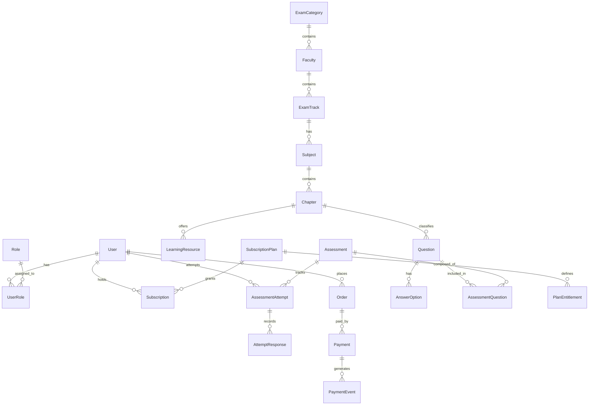

# Database Schema & Entity Relational Design

The database uses PostgreSQL 16 managed through Prisma ORM.

## 1. Entity Relationship Overview

---

## 2. Key Tables & Field Definitions

### 2.1 Identity & Access Control

- `User`: `id (UUID)`, `email (unique)`, `passwordHash`, `fullName`, `phoneNumber`, `isActive`, `createdAt`, `updatedAt`
- `Role`: `id (UUID)`, `name (ADMIN, STUDENT, CONTENT_EDITOR, INSTRUCTOR)`, `description`
- `UserRole`: `userId`, `roleId`

### 2.2 Educational Hierarchy

- `ExamCategory`: `id (UUID)`, `code (NEC, LOK_SEWA, DIPLOMA)`, `title`, `description`, `iconUrl`, `displayOrder`, `isPublished`
- `Faculty`: `id (UUID)`, `categoryId`, `name (Civil, Electrical, Mechanical, etc.)`, `code`, `displayOrder`
- `ExamTrack`: `id (UUID)`, `facultyId`, `name (e.g. Officer 7th Level / Assistant 5th Level)`, `description`
- `Subject`: `id (UUID)`, `examTrackId`, `name`, `code`, `iconUrl`, `displayOrder`
- `Chapter`: `id (UUID)`, `subjectId`, `title`, `chapterNumber`, `description`, `isFreePreview`
- `LearningResource`: `id (UUID)`, `chapterId`, `title`, `resourceType (NOTES, PDF, SYLLABUS, VIDEO)`, `content (RichText)`, `fileUrl`, `fileSizeBytes`, `isFreePreview`

### 2.3 Question Bank & Assessments

- `Question`: `id (UUID)`, `chapterId`, `questionText`, `richMediaUrl`, `difficulty (EASY, MEDIUM, HARD)`, `marks (Decimal)`, `negativeMarks (Decimal)`, `status (DRAFT, PUBLISHED, ARCHIVED)`, `explanationText`
- `AnswerOption`: `id (UUID)`, `questionId`, `optionLabel (A, B, C, D)`, `optionText`, `isCorrect (Boolean)`
- `Assessment`: `id (UUID)`, `subjectId (optional)`, `title`, `type (CHAPTER_PRACTICE, FULL_MOCK)`, `totalMarks (Decimal)`, `passMarks (Decimal)`, `durationMinutes (Int)`, `isFree (Boolean)`, `isPublished (Boolean)`
- `AssessmentAttempt`: `id (UUID)`, `userId`, `assessmentId`, `status (IN_PROGRESS, SUBMITTED, EXPIRED)`, `startedAt`, `expiresAt`, `submittedAt`, `scoreObtained (Decimal)`, `totalMarks (Decimal)`, `accuracyRate (Decimal)`
- `AttemptResponse`: `id (UUID)`, `attemptId`, `questionId`, `selectedOptionId`, `isCorrect (Boolean)`, `marksAwarded (Decimal)`, `timeSpentSeconds (Int)`, `isMarkedForReview (Boolean)`

### 2.4 Subscriptions & Orders

- `SubscriptionPlan`: `id (UUID)`, `name (Monthly, Quarterly, Annual)`, `code`, `durationDays (Int)`, `priceNpr (Decimal)`, `discountNpr (Decimal)`, `isActive`
- `PlanEntitlement`: `id (UUID)`, `planId`, `categoryId`, `canAccessNotes`, `canAccessPractice`, `canAccessFullMock`
- `Subscription`: `id (UUID)`, `userId`, `planId`, `status (ACTIVE, EXPIRED, CANCELLED)`, `startDate`, `endDate`, `autoRenew`
- `Order`: `id (UUID)`, `orderNumber (unique)`, `userId`, `planId`, `amountNpr (Decimal)`, `status (PENDING, PAID, FAILED, CANCELLED)`
- `Payment`: `id (UUID)`, `orderId`, `gateway (ESEWA, KHALTI)`, `gatewayTransactionId`, `amountNpr (Decimal)`, `status (INITIATED, SUCCESS, FAILED, REFUNDED)`, `rawResponse (JSON)`
- `AuditLog`: `id (UUID)`, `userId`, `action`, `resourceType`, `resourceId`, `payload (JSON)`, `ipAddress`, `createdAt`
