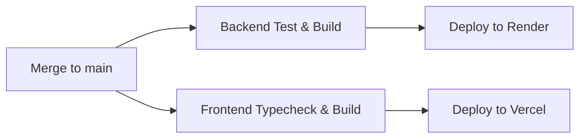

# Deployment Architecture & CI/CD Guide

This guide describes how **ExamSathi Nepal** is deployed using **Vercel** (Frontend) and **Render** (Backend), with automated CI/CD triggered on merge to the `main` branch.

---

## 1. Architecture Overview

| Component | Platform | Runtime | Build Command | Start Command / Output |
| :--- | :--- | :--- | :--- | :--- |
| **Frontend** (`frontend/`) | **Vercel** | Next.js 15 (App Router) | `next build` | Next.js Serverless Edge / Node |
| **Backend** (`backend/`) | **Render** | Node.js 22 (NestJS 11) | `npm ci && npm run db:generate && npm run build` | `npm run start:prod` |
| **Database** | Managed PostgreSQL (Aiven, Render, Supabase, RDS) | PostgreSQL 15+ | `npx prisma db push` (via `preDeployCommand`) | Persistent relational store |

---

## 2. Backend Deployment on Render

### Option A: 1-Click Render Blueprint (Recommended)

The repository includes a top-level `render.yaml` Blueprint specification.

1. Go to the [Render Dashboard](https://dashboard.render.com).
2. Click **New +** -> **Blueprint**.
3. Select the `GyanDwar` repository.
4. Render automatically parses `render.yaml` and provisions the `examsathi-backend` Web Service with:
   - Root Directory: `backend`
   - Build Command: `npm ci && npm run db:generate && npm run build`
   - Pre-Deploy Command: `npx prisma db push --schema=./prisma/schema.prisma` (syncs database schema before traffic is routed)
   - Start Command: `npm run start:prod`
   - Health Check Path: `/api/v1/health/liveness`
5. Supply the required environment variables:
   - `DATABASE_URL`: Your PostgreSQL connection string.
   - `APP_URL`: Your live Vercel frontend URL (e.g. `https://examsathi.vercel.app`).
   - `API_URL`: Your Render backend URL (e.g. `https://examsathi-backend.onrender.com`).

### Option B: Manual Web Service Creation on Render

If you prefer configuring the Web Service manually:

1. In Render Dashboard, click **New +** -> **Web Service**.
2. Connect your GitHub repository.
3. Configure the service settings:
   - **Name**: `examsathi-backend`
   - **Language**: `Node`
   - **Branch**: `main`
   - **Root Directory**: `backend`
   - **Build Command**: `npm ci && npm run db:generate && npm run build`
   - **Pre-Deploy Command**: `npx prisma db push --schema=./prisma/schema.prisma`
   - **Start Command**: `npm run start:prod`
   - **Health Check Path**: `/api/v1/health/liveness`
4. Under **Environment Variables**, configure:

| Variable | Recommended Value | Description |
| :--- | :--- | :--- |
| `NODE_ENV` | `production` | Production environment flag |
| `PORT` | `10000` | Render internal listener port |
| `DATABASE_URL` | `postgresql://...` | Production PostgreSQL connection string |
| `JWT_SECRET` | *(64-char random hex)* | Token signing key |
| `JWT_REFRESH_SECRET` | *(64-char random hex)* | Refresh token signing key |
| `JWT_EXPIRES_IN` | `7d` | Token expiry |
| `JWT_REFRESH_EXPIRES_IN` | `30d` | Refresh token expiry |
| `APP_URL` | `https://your-frontend.vercel.app` | Vercel frontend URL for CORS |
| `API_URL` | `https://your-backend.onrender.com` | Public backend URL |
| `ESEWA_MERCHANT_CODE` | `EPAYTEST` | eSewa merchant ID (or production code) |
| `ESEWA_SECRET_KEY` | `8gBm/:&EnhH.1/q` | eSewa secret (or production secret) |
| `ESEWA_BASE_URL` | `https://rc-epay.esewa.com.np` | Gateway endpoint |
| `KHALTI_BASE_URL` | `https://a.khalti.com/api/v2` | Khalti endpoint |

---

## 3. Frontend Deployment on Vercel

### Step 1: Connect Repository to Vercel

1. Log into [Vercel](https://vercel.com).
2. Click **Add New...** -> **Project**.
3. Import the `GyanDwar` repository.
4. Under **Project Settings**:
   - **Framework Preset**: Next.js
   - **Root Directory**: Click `Edit` and select `frontend`.
5. Under **Environment Variables**, add:

| Variable | Value | Description |
| :--- | :--- | :--- |
| `NEXT_PUBLIC_API_URL` | `https://your-backend.onrender.com/api/v1` | URL of your Render backend API |
| `NEXT_PUBLIC_APP_URL` | `https://your-frontend.vercel.app` | URL of your Vercel frontend |

6. Click **Deploy**.

---

## 4. GitHub Actions CI/CD Pipeline (`.github/workflows/ci.yml`)

The pipeline runs on every Pull Request and Push. When changes are merged into the `main` branch, the pipeline executes the following stages:



### GitHub Secrets Configuration

To enable automated deployments via GitHub Actions, configure the following secrets under **Settings** -> **Secrets and variables** -> **Actions** in your GitHub repository:

#### For Render:
- `RENDER_DEPLOY_HOOK_URL`:
  1. In the Render Dashboard, open your `examsathi-backend` Web Service.
  2. Navigate to **Settings** -> **Deploy Hook**.
  3. Copy the URL (`https://api.render.com/deploy/srv-xxxx?key=yyyy`).
  4. Paste into GitHub Secrets as `RENDER_DEPLOY_HOOK_URL`.

#### For Vercel:
- `VERCEL_TOKEN`: Create a personal access token at [vercel.com/account/tokens](https://vercel.com/account/tokens).
- `VERCEL_ORG_ID`: Found in your Vercel Project Settings or `~/.vercel/project.json`.
- `VERCEL_PROJECT_ID`: Found in your Vercel Project Settings -> General -> Project ID.

> **Note**: If you prefer Vercel's native GitHub App auto-deploy integration, you do not need `VERCEL_TOKEN`. Vercel will automatically build and deploy `frontend` upon commit to `main`, and the GitHub Actions workflow will log an informational notice without failing the build.

---

## 5. Pre-Completion Verification Checklist

Before opening PRs or merging to `main`, verify locally:

```bash
# 1. Backend Verification
cd backend
npm run build
npm test

# 2. Frontend Verification
cd ../frontend
npm run build
```
